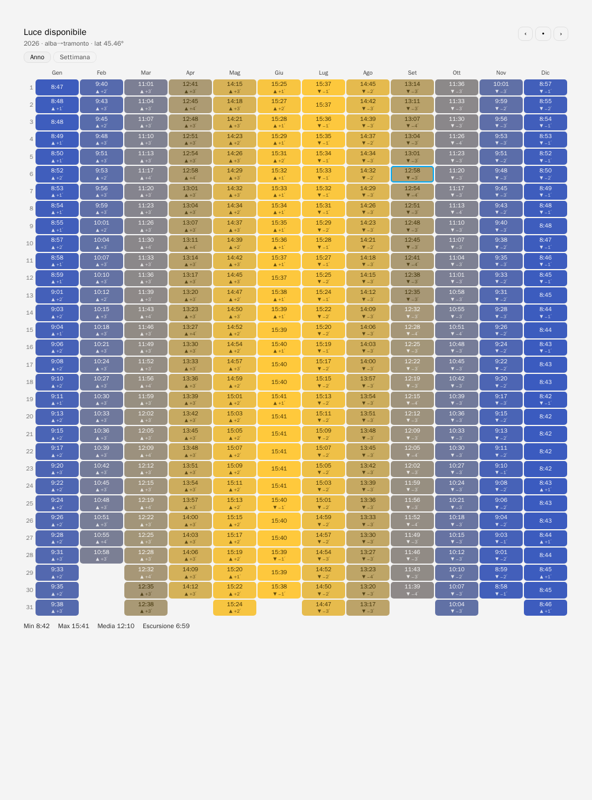
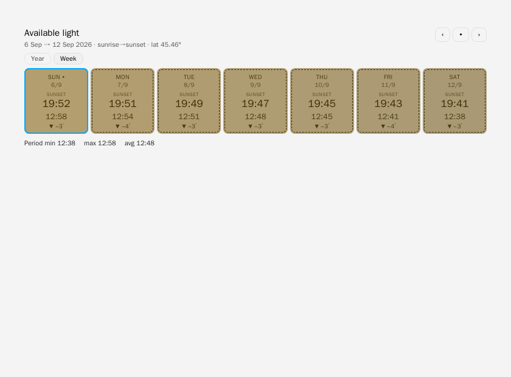
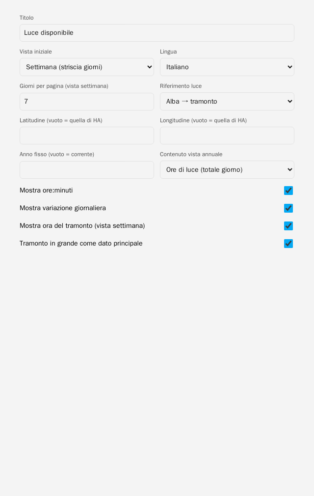

# Daylight Heatmap Card

[English](README.md) | Italiano

[](https://my.home-assistant.io/redirect/marketplace_repository/?owner=tosolini&repository=daylight-heatmap-card&category=plugin)
[](https://my.home-assistant.io/redirect/hacs_repository/?owner=tosolini&repository=daylight-heatmap-card&category=plugin)

Visione tabellare della **luce disponibile giorno per giorno**, espressa in **ore:minuti** — stile
[temperature-heatmap-card](https://github.com/zanac/temperature-heatmap-card), ma senza sensori:
la durata è calcolata astronomicamente da **latitudine + giorno dell'anno**. Funziona offline,
mostra passato e futuro, nessun recorder, nessuna API esterna.

Vista **Anno** (default): tabella 12 mesi × 31 giorni con ore di luce oppure ora del tramonto (selettore nella GUI), ‹ › spostano di un anno.
Vista **Settimana**: striscia di N giorni da oggi in avanti, ‹ › spostano
di N giorni — indietro nel passato e avanti nel futuro (deterministico, bordo tratteggiato).
Colore = durata (blu inverno → giallo estate, scala fissa sull'anno così i colori
non saltano navigando), testo = `H:MM`, delta `±min` vs giorno prima, oggi evidenziato.





## Installazione

### Marketplace (Home Assistant ≥ 2026.11)
Clicca sul pulsante **Apri nel Marketplace** qui sopra, oppure vai in **Impostazioni** → **Marketplace** → cerca `Daylight Heatmap Card` e clicca **Installa**.

### HACS (Home Assistant < 2026.11)
1. Clicca sul pulsante **Apri in HACS** qui sopra, oppure HACS → Frontend → ⋮ → Custom repositories → URL di questo repo, categoria `Lovelace`.
2. Installa, poi Impostazioni → Dashboard → ⋮ → Risorse → Aggiungi `/hacsfiles/daylight-heatmap-card/daylight-heatmap-card.js` tipo **JavaScript Module**.

### Manuale
Copia `daylight-heatmap-card.js` in `config/www/`, risorsa `/local/daylight-heatmap-card.js?v=0.4.4` tipo modulo.

> Cache di HA: a ogni aggiornamento cambia `?v=…` e ricarica con Ctrl+Maiusc+R.
> Verifica in Strumenti sviluppo → Console: `DAYLIGHT-HEATMAP-CARD 0.4.4`. Tieni UNA sola risorsa: se restano sia `/hacsfiles/…` che `/local/…`, vince la prima caricata e il fix non si vede.

## Configurazione

**Editor visuale:** Aggiungi card → cerca "Daylight" →
compili titolo, vista, giorni, riferimento luce, lingua, latitudine/anno opzionali
e gli interruttori (ore, variazione, tramonto, tramonto in grande) — anteprima live, niente YAML. Lo YAML sotto resta valido
per chi preferisce il testo.

```yaml
type: custom:daylight-heatmap-card
title: Luce disponibile
view: year               # year | week (switch live Anno/Settimana comunque presente nella card)
days: 7                 # solo vista week: 3–14 giorni per pagina
mode: sunrise_sunset   # sunrise_sunset | civil | nautical | astronomical
show_delta: true
year_value: hours       # solo vista year: hours | sunset (ora del tramonto al posto del totale)
lang: it               # it | en
# latitude: 45.46      # default: hass.config.latitude
# year: 2026           # solo vista year: fissa l'anno base (default: corrente)
```

| Opzione | Effetto |
|---|---|
| `mode: sunrise_sunset` | alba→tramonto (zenit 90.833°). Default, è "quanta luce" per la maggior parte degli usi |
| `mode: civil` | include crepuscolo civile (zenit 96°) — luce utile all'aperto |
| `mode: nautical / astronomical` | crepuscoli nautico/astronomico, per usi specifici |
| `latitude` | override; default latitudine di HA (quindi niente da configurare) |
| `show_delta` | `+1′`/`−1′` vs giorno prima — rende visibile l'allungarsi delle giornate |
| `sunset_big` | tramonto in grande come dato principale vista week (default `true`) — interruttore nella GUI |
| `year_value` | contenuto celle vista year: `hours` (totale luce) o `sunset` (ora del tramonto) — selettore nella GUI |

## Perché non serve Home Assistant per i dati

La durata del dì dipende solo da latitudine e giorno (declinazione solare), non da
longitudine/fuso: `durata = 2·H/15`, `cosH = (cosZ − sinφ·sinδ)/(cosφ·cosδ)`.
Il `sun.sun` di HA dà solo gli orari di oggi/domani; il recorder non ha il futuro.
Calcolo in-card = tabella annuale completa, anche anni futuri, zero dipendenze.
Accuratezza ~1–2 min (verificato: Milano solstizio estivo 15:41, invernale 8:42).
Ai poli gestisce giorno/notte polare (24:00 / 0:00).

## Sviluppo

```bash
docker run --rm -v $(pwd):/workspace -w /workspace node:20-alpine node --check daylight-heatmap-card.js
```

## Crediti

Card di [Walter Tosolini](https://www.tosolini.info).
Realizzata con AI e [OMP.sh](https://omp.sh).
