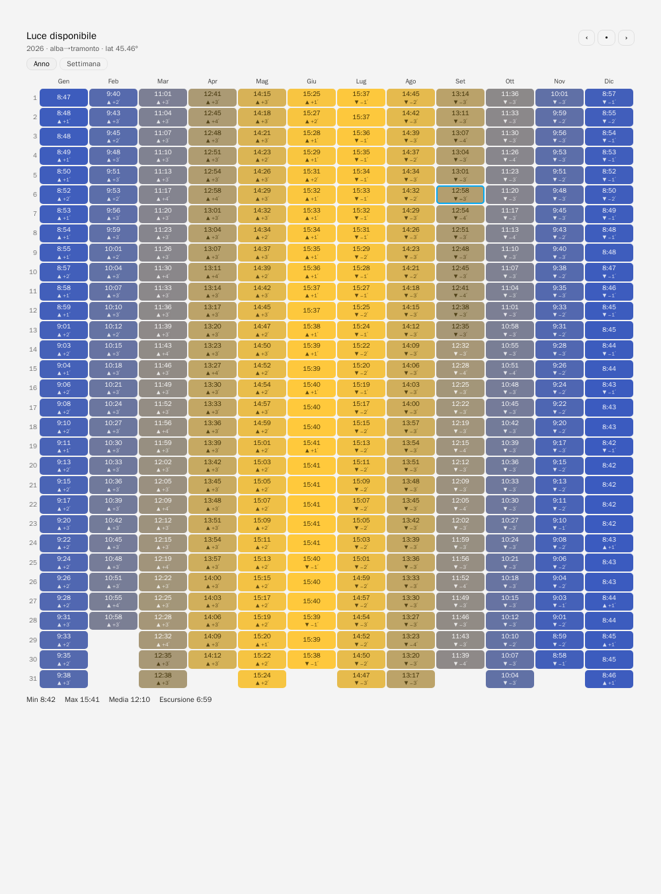
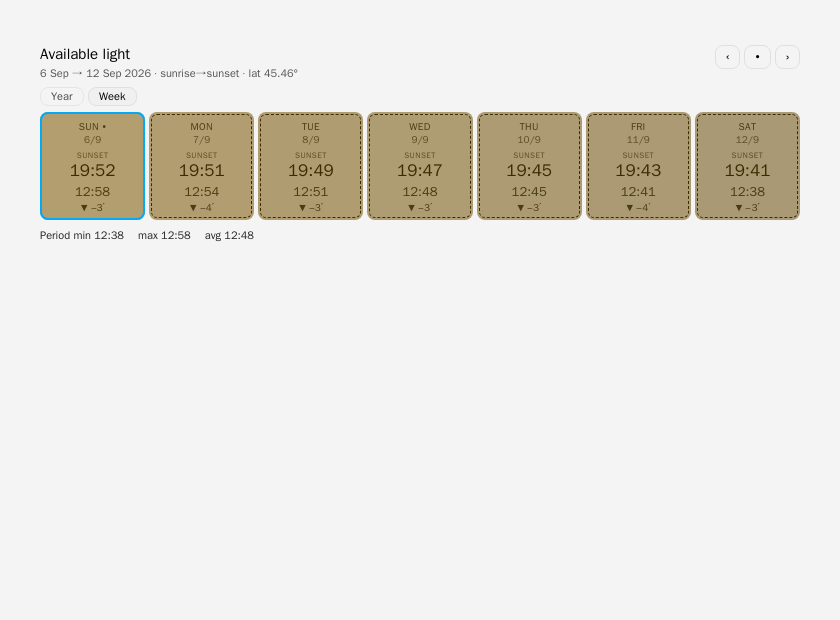
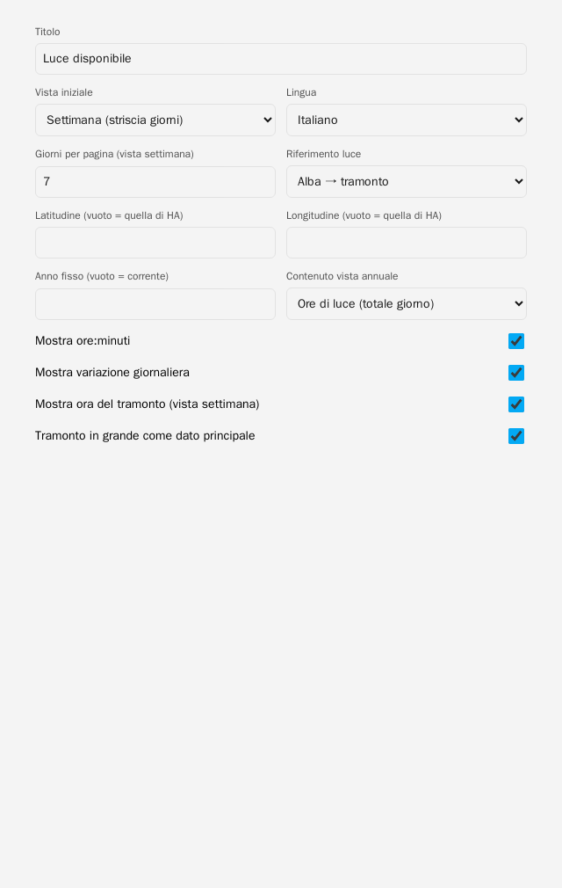

# Daylight Heatmap Card

English | [Italiano](README.it.md)

[](https://my.home-assistant.io/redirect/marketplace_repository/?owner=tosolini&repository=daylight-heatmap-card&category=plugin)

Tabular view of **available daylight, day by day**, in **hours:minutes** — styled after
[temperature-heatmap-card](https://github.com/zanac/temperature-heatmap-card), but with no sensors:
day length is computed astronomically from **latitude + day of year**. Works offline,
past and future, no recorder, no external API.

**Year** view (default): 12 months × 31 days table with daylight totals or sunset times (GUI selector), ‹ › move one year.
**Week** view: strip of N days starting today, ‹ › move
N days — back into the past and forward into the future (deterministic, dashed border).
Color = duration (winter blue → summer yellow, fixed yearly scale so colors
don't jump while navigating), text = `H:MM`, delta `±min` vs previous day, today highlighted.





## Installation

### Marketplace (Home Assistant ≥ 2026.11)
Click the **Open in Marketplace** button above, or go to **Settings** → **Marketplace** → search for `Daylight Heatmap Card` and click **Install**.

### HACS (Home Assistant < 2026.11)
1. Click the **Open in HACS** button above, or go to HACS → Frontend → ⋮ → Custom repositories → this repo's URL, `Lovelace` category.
2. Install, then Settings → Dashboards → ⋮ → Resources → add `/hacsfiles/daylight-heatmap-card/daylight-heatmap-card.js` as **JavaScript Module**.

### Manual
Copy `daylight-heatmap-card.js` to `config/www/`, resource `/local/daylight-heatmap-card.js?v=0.4.4` as module.

> HA caches frontend resources: after each update bump `?v=…` and hard-refresh (Ctrl+Shift+R).
> Check DevTools → Console for `DAYLIGHT-HEATMAP-CARD 0.4.4`. Keep a SINGLE resource: if both `/hacsfiles/…` and `/local/…` remain, the first one loaded wins.

## Configuration

**Visual editor:** add card → search "Daylight" →
fill in title, view, days, light reference, language, optional latitude/year
and the switches (hours, change, sunset, big sunset) — live preview, no YAML. The YAML below still works
for those who prefer text.

```yaml
type: custom:daylight-heatmap-card
title: Available light
view: year               # year | week (live Year/Week switch is always present on the card)
days: 7                 # week view only: 3–14 days per page
mode: sunrise_sunset   # sunrise_sunset | civil | nautical | astronomical
show_delta: true
year_value: hours       # year view only: hours | sunset (sunset time instead of the total)
lang: en               # it | en
# latitude: 45.46      # default: hass.config.latitude
# year: 2026           # year view only: pins the base year (default: current)
```

| Option | Effect |
|---|---|
| `mode: sunrise_sunset` | sunrise→sunset (zenith 90.833°). Default, "how much light" for most uses |
| `mode: civil` | includes civil twilight (zenith 96°) — usable outdoor light |
| `mode: nautical / astronomical` | nautical/astronomical twilight, for specific uses |
| `latitude` | override; defaults to HA latitude (so nothing to configure) |
| `show_delta` | `+1′`/`−1′` vs previous day — makes lengthening days visible |
| `sunset_big` | big sunset as the primary week-view datum (default `true`) — GUI switch |
| `year_value` | year-view cell content: `hours` (light total) or `sunset` (sunset time) — GUI selector |

## Why no Home Assistant data is needed

Day length depends only on latitude and day (solar declination), not on
longitude/timezone: `duration = 2·H/15`, `cosH = (cosZ − sinφ·sinδ)/(cosφ·cosδ)`.
HA's `sun.sun` only gives today's/tomorrow's times; the recorder has no future.
In-card computation = full yearly table, even future years, zero dependencies.
Accuracy ~1–2 min (verified: Milan summer solstice 15:41, winter 8:42).
At the poles it handles polar day/night (24:00 / 0:00).

## Development

```bash
docker run --rm -v $(pwd):/workspace -w /workspace node:20-alpine node --check daylight-heatmap-card.js
```

## Credits

Card by [Walter Tosolini](https://www.tosolini.info).
Made with AI and [OMP.sh](https://omp.sh).
