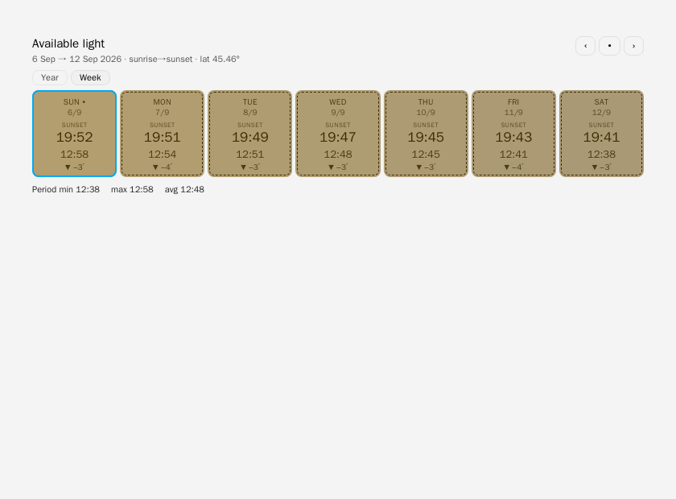

# Daylight Heatmap Card

Daylight hours or sunset times, day by day — no sensors, no APIs. The card computes
astronomically from latitude + day of year, so it works offline, in the past and in the future.

- **Year:** 12 × 31 table (daylight total or sunset time per day)
- **Week:** strip of N days from today onward, with sunset times and daily deltas
- Visual GUI editor included, English + Italian

See [README](https://github.com/tosolini/daylight-heatmap-card/blob/main/README.md) for installation and configuration.

